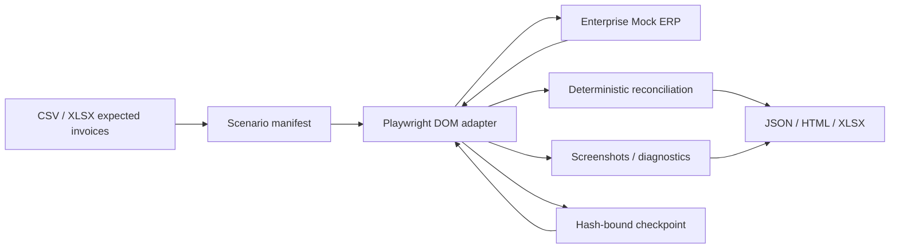

# SOC Agent Project Overview

## Positioning

SOC Agent is a macOS business automation platform for workflows that span
desktop applications, browser-based ERPs, and local business files. Its first
reference product is deterministic invoice reconciliation.

The project is designed around auditable execution rather than free-form agent
clicking:

- deterministic business rules decide whether data matches
- browser DOM data is preferred over screenshot interpretation
- every lookup retains evidence and diagnostics
- failed work can retry, resume, or stop without corrupting other records
- final output is available as JSON, HTML, and XLSX
- the local console supports file upload, run status, logs, and artifact download
- operator tokens and roles protect review actions
- review decisions have a hash-chained append-only audit history
- completed runs can be closed with a content-integrity fingerprint
- deterministic reports can be packaged with SHA-256 evidence manifests

## Problem

Finance and operations teams often export expected invoice data to Excel, then
manually search an ERP for every invoice and compare amount, currency, status,
and duplicates.

This work is repetitive, difficult to audit, and error-prone when an ERP page
loads slowly or returns partial results.

## Demo Scenario

The repository includes a stateful enterprise-like Mock ERP with:

- username/password login
- cookie sessions and expiry
- invoice search
- pagination
- slow response and one-time 5xx injection
- duplicate and missing records
- CSV export

The scenario runs 20 synthetic invoices through:

```text
CSV/XLSX expected data
  -> enterprise Mock ERP login
  -> Chrome + Playwright
  -> DOM field extraction
  -> deterministic reconciliation
  -> screenshots and diagnostics
  -> checkpoint
  -> JSON/HTML/XLSX reports
```

## Architecture



## Reliability Design

- field mappings and status/currency aliases are configuration
- selector changes are configuration, not Python changes
- transient browser and 5xx failures retry with diagnostics
- per-invoice failures do not stop the remaining batch
- successful lookups are persisted atomically
- CSV and mapping changes invalidate old checkpoints
- login redirects trigger automatic re-authentication
- credentials can come from environment variables

## Real ERP Boundary

The project does not claim validation against a customer ERP. A real deployment
would provide:

- ERP test URL and login method
- page screenshots and selector calibration
- business-specific status mappings
- tolerance, partial payment, credit note, and tax rules
- redaction and write-permission policy

Those changes affect the adapter and rules configuration, while the queue,
retry, checkpoint, reporting, and scenario layers remain reusable.

## Interview Walkthrough

1. Show the business problem and sample Excel input.
2. Run the one-click demo.
3. Show login, pagination, 503 retry, and slow-load behavior.
4. Open the HTML report and filter differences.
5. Open the XLSX workbook and follow a screenshot evidence link.
6. Explain checkpoint resume and configuration fingerprints.
7. Show unit tests and the local Mock ERP fault matrix.
